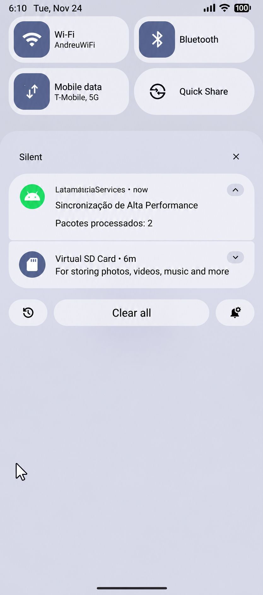
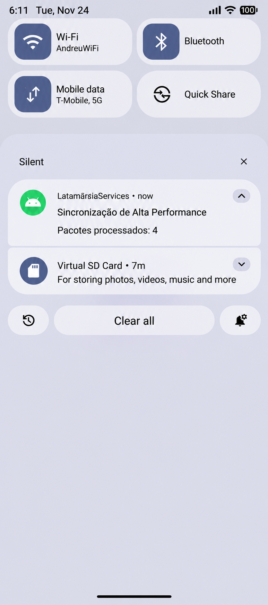
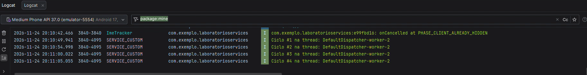
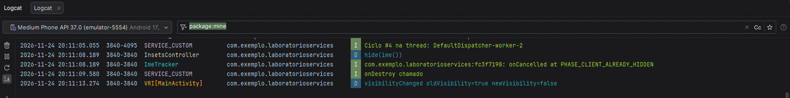

# Laboratório de Services - Android

Foreground Service em Kotlin com Corrotinas e notificação atualizada dinamicamente

---

## Identificação

| | |
|---|---|
| **Aluno** | FELIPE CALDERARO |
| **Curso** | CIÊNCIA DA COMPUTAÇÃO - UNINORTE |
| **Disciplina** | DESENVOLVIMENTO MOBILE |
| **Atividade** | Módulo 4 - Desafio 3 |

## Sobre

Neste trabalho criei um app Android em Kotlin com um Foreground Service. O serviço roda em segundo plano e, a cada 5 segundos, atualiza o texto da própria notificação mostrando quantos pacotes já foram processados (Desafio 3).

## Como funciona

1. Dois botões na tela: **Iniciar Serviço** e **Parar Serviço**.
2. Ao iniciar, o serviço mostra uma notificação fixa e começa uma corrotina em `Dispatchers.IO`, para não travar a tela.
3. A cada 5 segundos o contador aumenta e a notificação é atualizada com `notify()` usando o mesmo ID, o que substitui a notificação em vez de criar outra.
4. Ao parar, o `onDestroy()` cancela a corrotina.
5. No Android 13 ou superior, o app pede a permissão de notificações ao abrir.

## Evidências

| Notificação (início) | Notificação (depois) |
|:---:|:---:|
|  |  |

Logcat filtrado por `SERVICE_CUSTOM`, com os ciclos na thread `DefaultDispatcher-worker`:

Encerramento do serviço (`onDestroy chamado`):

## Como executar

1. Abrir o projeto no Android Studio e aguardar a sincronização do Gradle.
2. Rodar em um emulador ou celular com Android 13 ou superior.
3. Permitir as notificações e tocar em **Iniciar Serviço**.
4. Filtrar o Logcat por `SERVICE_CUSTOM` para acompanhar os ciclos.